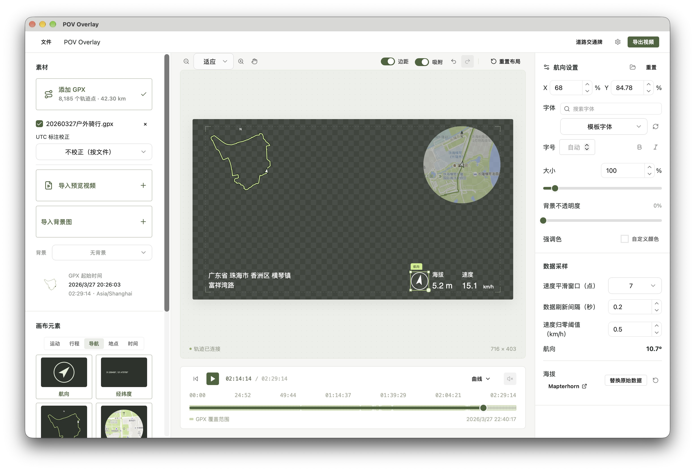

# POV Overlay

本地 GPX 叠加层编辑器，可在视频、图片或透明背景上预览运动数据，自由排布元素并保存预设。采用 **Vue 3 + TypeScript + Hikari** 与 **Tauri 2 + Rust**。



## 功能

- 多段 GPX 导入与时间拼合，支持纯 GPX 播放、视频时间对齐、速度平滑及速度/海拔曲线。
- 自由拖动、缩放、吸附、锁定和显隐画布元素，支持撤销/重做。
- 内置运动、行程、时间、导航和地点元素，支持自定义 SVG、动态字段和多行文本。
- 离线路线、在线小地图、地形海拔替换及省市区、道路名称与编号显示。
- 命名保存与载入预设；独立道路交通牌制作与 SVG 导出。
- 桌面端导出透明或绿幕叠加层视频，供剪辑软件叠加使用；背景视频和图片仅用于预览，不进入输出。

素材默认在本地处理。在线地图、海拔和地址查询按需联网，高德 Key 仅保存在本机。

## 启动

要求 Node.js 22.13+、pnpm 11.24.0（由 `package.json` 固定）、Rust stable 及 [Tauri 系统开发依赖](https://v2.tauri.app/start/prerequisites/)。

```sh
pnpm install --frozen-lockfile
pnpm tauri dev
```

浏览器开发预览运行 `pnpm dev`，访问 `http://127.0.0.1:1420`。视频、图片均为可选背景，导入自己的 GPX 即可播放。

视频导出需安装本地 FFmpeg，macOS 可用 `brew install ffmpeg`；也可在「设置 → FFmpeg」指定路径。浏览器模式不提供视频编码、地形海拔获取和实际地址查询。预设需手动保存。

## 使用文档

| 文档 | 内容 |
| --- | --- |
| [使用指南](docs/usage.md) | 素材、画布操作、快捷键、字体、预设与应用设置 |
| [SVG 自定义](docs/svg.md) | 制作与导入、字段含义与单位、动态图形范例 |
| [GPX 数据与时间](docs/gpx.md) | 时间对齐、UTC 标注校正、平滑、航向与多文件拼合 |
| [地图、海拔与地点](docs/maps.md) | 路线、小地图、海拔替换、地址查询与道路编号 |
| [叠加层视频导出](docs/export.md) | 格式、帧率、倍速工作流、硬件编码与透明通道 |
| [道路交通牌制作](docs/road-signs.md) | 标牌模板、文字排版、SVG 导出与字体来源 |
| [开发说明](docs/development.md) | 目录结构、分层、依赖与检查命令 |
